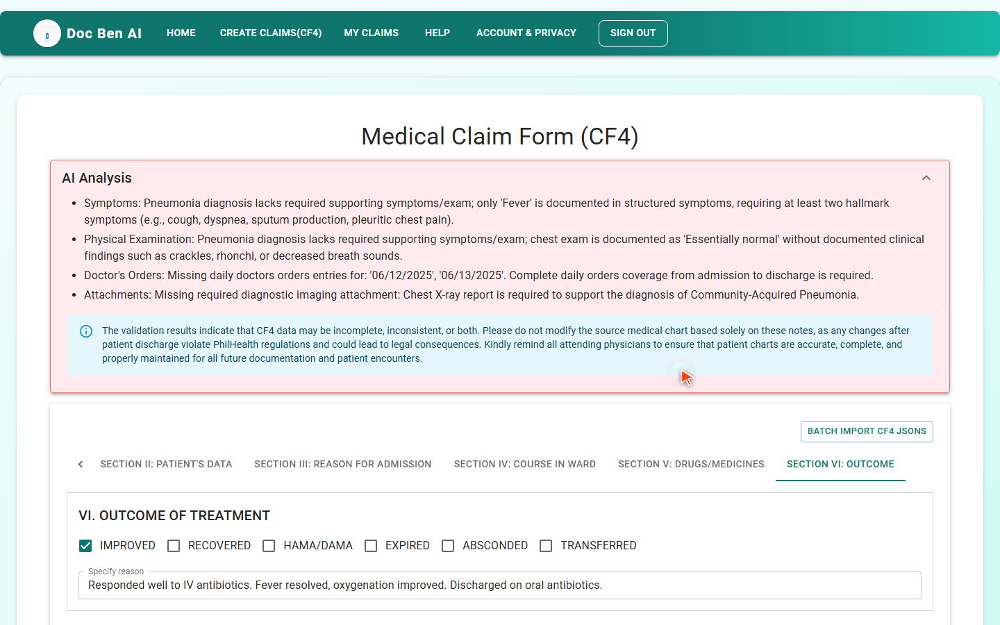
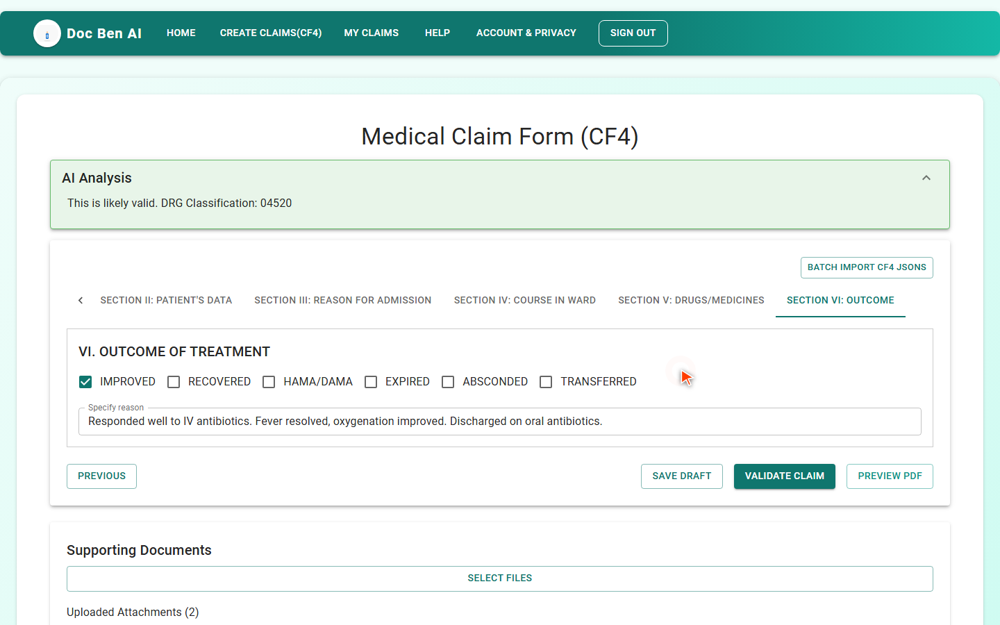

# DocBen Web App — User Guide

The **DocBen web app** is the no-code way to use DocBen's claim validation. Your team enters a claim in the browser, clicks **Validate Claim**, and sees every problem on screen — before the claim goes to PhilHealth.

> **Two ways to adopt DocBen.** This guide covers **Path A, the web app**. If you would rather have your own system (HIS, EMR, billing software) send claims automatically, see **Path B, the [API integration guide](../cf4-api/)**. Both paths use the same validation engine and the same PhilHealth rules.

> **Open the web app:** <https://lrama1.github.io/docben-ai3/>

> 🎬 **Prefer video?** [Watch the 3½-minute demo](../videos/docben-ai-create-claim-demo.mp4) — it creates a claim, validates it, reads the findings, fixes them, and re-validates.

> ⚠️ **Early access.** The web app is in alpha. All sample data in this guide and in the demo video is fictional.

---

## What you get

- A step-by-step form for the PhilHealth **CF4** claim, in six sections.
- Upload of **supporting documents** (images or PDF) alongside the claim.
- One-click validation with an **AI Analysis** panel that lists each issue and explains why.
- A **0–100 quality score**, the **rejection reasons**, and the **DRG classification** once the claim is valid.
- Saved claims, so you can come back, fix, and re-validate.

---

## Getting started

1. **Open the web app** and create an account.
2. **Enter your registration code.** Your DocBen administrator gives you a registration code that links your account to your organization. You need it before you can create claims.
3. **Sign in** and open the claims page.

---

## Creating and validating a claim

1. **Start a new claim.**
2. **Fill in the six CF4 sections:**
   1. Health care institution (HCI)
   2. Patient
   3. Reason for admission
   4. Course in the ward
   5. Drugs and medicines
   6. Outcome of treatment
3. **Attach supporting documents** — for example lab results and imaging reports. The validator reads them and compares them with what the claim says.
4. **Click _Validate Claim_.** Validation takes a few moments.
5. **Read the AI Analysis panel.** Each finding names the problem and why it matters. Typical findings:
   - a symptom or exam finding in the claim that no document supports
   - doctor's orders that are missing
   - an imaging or lab report that is referenced but not attached
6. **Fix the claim** — edit the fields or attach the missing document — and click **Validate Claim** again.
7. **Repeat until the panel reads _“This is likely valid.”_** The DRG classification is shown with it, and the claim is ready to submit.

*Before: four issues found. Each one says what is wrong and why.*

*After the fixes: the claim reads as likely valid, with its DRG classification.*

---

## Tips

- **Validate early and often.** Re-validating after each fix is the quickest way to learn what the validator needs.
- **Attach before you validate.** Most “unsupported” findings disappear once the matching report is attached.
- **Treat the result as a pre-submission check.** It tells you what PhilHealth is likely to question; it does not replace your own review.

---

## Need to integrate instead?

If you would rather send claims from your own software, use the DocBen API:

- [API integration guide](../cf4-api/) — authentication, quotas, endpoints, attachments, errors, FAQ
- [Client examples](../cf4-api/examples/) — JavaScript and TypeScript
- [Browser test client](../cf4-api/test-client/) — try the live API from your browser
- [OpenAPI spec](../cf4-api/openapi.yaml)

Questions about web app access? Contact your DocBen account manager.
